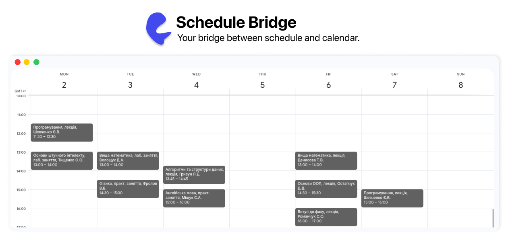
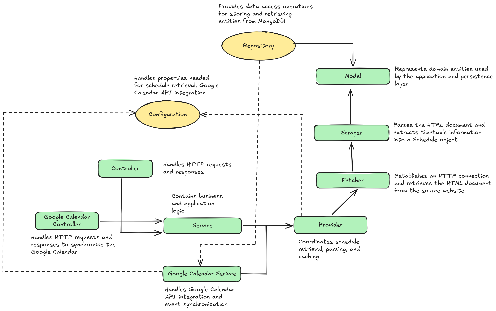

<div align="center">

# Schedule Bridge API

**Bridging University Schedules with Your Calendar.**

<a href="README.md">English</a> |
<a href="README_UK.md">Українська</a> |
<a href="https://eternaltempted.github.io/schedule-bridge/">Website</a>

<p>
  A Java / Spring Boot application for working with university
  schedule data through a REST API and integrating lessons
  with external services such as Google Calendar.
</p>

<picture>
  <source media="(prefers-color-scheme: dark)" srcset="assets/img/calendar-dark.png">
  <source media="(prefers-color-scheme: light)" srcset="assets/img/calendar-light.png">
  
</picture>

</div>

> [!WARNING]
> ## Data Source Notice
>
> This project retrieves timetable data from the official Kharkiv
> National University of Economics schedule website.
>
> The website's `robots.txt` file disallows automated crawling
> for general user agents. Please respect the source website's
> access policies.
>
> This is an independent project and is not affiliated with
> or endorsed by the university.

## About

The project started as an experiment in converting a university timetable into Java structured objects and exposing that data through a REST API.

It later became a practical backend project for learning:

- Java
- Spring Boot
- REST API design
- Layered Architecture
- Caching with Caffeine
- unit and controller testing
- date and time handling
- HTML parsing with jsoup
- Google Calendar API integration

## Features

The API can retrieve a schedule for an academic week, return today's lessons, synchronise the calendar with the next academic week, and return the next upcoming lesson.

Schedule data is represented by the `Schedule` and `Lesson` models,
which are used by the schedule endpoints.

The `LessonDTO` model defines the structure of lesson documents
stored in MongoDB and used by the calendar integration.

The application also separates HTTP communication, business logic, 
and schedule acquisition into controller, service, and provider layers.

## API Usage

Schedule Bridge exposes a REST API for retrieving university schedules and synchronising lessons with Google Calendar.

### Retrieve Schedule

Retrieve university schedule data in JSON format using different endpoints and query parameters.

```bash
# Get lessons for a specific week
curl -X GET "http://localhost:8080/api/schedule?week=10"

# Filter lessons by week and day
curl -X GET "http://localhost:8080/api/schedule?week=10&day=MONDAY"

# Get today's schedule
curl -X GET "http://localhost:8080/api/schedule/today"

# Get the upcoming lesson
curl -X GET "http://localhost:8080/api/schedule/next"
```

### Synchronise with Google Calendar

Send a POST request to synchronise your schedule with Google Calendar. You can synchronise a specific week, the upcoming week, or the default schedule.

```bash
# Synchronize the default schedule
curl -X POST "http://localhost:8080/api/calendar/sync"

# Synchronize a specific week
curl -X POST "http://localhost:8080/api/calendar/sync?week=10"

# Synchronize the upcoming week
curl -X POST "http://localhost:8080/api/calendar/sync/next"
```

An individual lesson is represented by the following JSON structure:

```json
{
  "date": "2026-09-12",
  "lessonNumber": 3,
  "startTime": "12:10",
  "endTime": "13:45",
  "subject": "English",
  "lessonType": "Lecture",
  "teacher": "Teacher"
}
```

## Technologies

The project is built with **Java 21, Spring Boot and Maven**. It also uses
**jsoup** for HTML parsing, **JUnit and Mockito** for testing, and **Caffeine**
for caching. 

**Google Calendar API** is used to create and manage calendar events
for university classes.

**MongoDB** stores previously retrieved schedule data to prevent
duplicate entries and manage existing classes.

## Architecture

The application is organised into distinct layers, each responsible for a specific part of the system.

<picture>
  <source media="(prefers-color-scheme: dark)" srcset="assets/img/architecture-dark.png">
  <source media="(prefers-color-scheme: light)" srcset="assets/img/architecture-light.png">
  
</picture>

## Disclaimer

The original schedule provider explicitly prohibits automated web scraping.
The data-acquisition component in this repository is retained only as part of
the project's development history and should not be used against that service.

## Licence

This repository is publicly available for educational and portfolio purposes.
No permission is granted to copy, modify, distribute, or use the source code
except as permitted by applicable law.

Copyright © 2026 eternaltempted. All rights reserved.

## Author

Developed and maintained by eternaltempted.

GitHub: https://github.com/eternaltempted