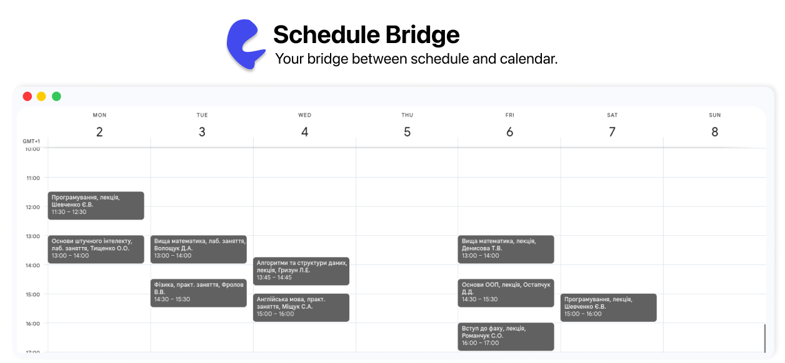
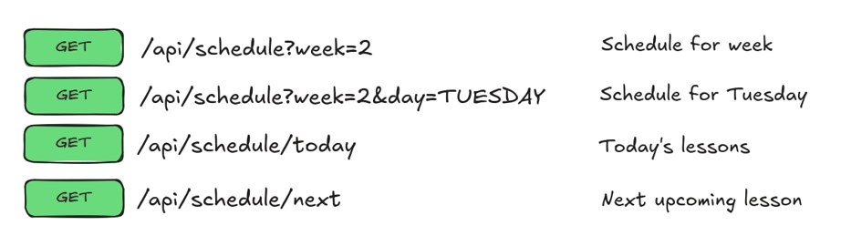
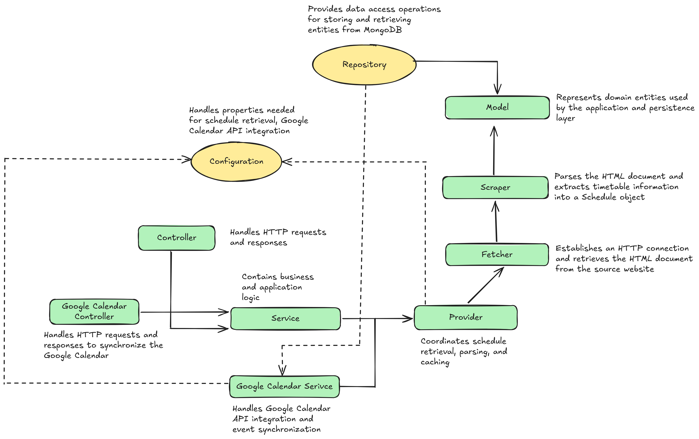

 <div align="center">

# Schedule Bridge API

**Поєднуємо університетський розклад із вашим календарем.**

<a href="README.md">English</a> |
<a href="README_UK.md">Українська</a> |
<a href="https://eternaltempted.github.io/schedule-bridge/">Вебсайт</a>

<p>
  Застосунок на Java та Spring Boot для роботи з даними університетського розкладу через REST API та інтеграції занять із зовнішніми сервісами, зокрема Google Calendar.
</p>

<picture>
  <source media="(prefers-color-scheme: dark)" srcset="assets/img/calendar-dark.png">
  <source media="(prefers-color-scheme: light)" srcset="assets/img/calendar-light.png">
  
</picture>

</div>

> [!WARNING]
> ## Статус проєкту: Архівовано
>
> Спочатку проєкт розроблявся для отримання даних про університетський розклад з офіційного вебсайту розкладу Харківського національного економічного університету імені Семена Кузнеця.
>
> Розробку початкового компонента отримання даних було припинено після спілкування з адміністраторами джерела щодо обмежень автоматизованого доступу та відсутності публічного API.
>
> Проєкт збережено з освітньою метою та для портфоліо. Він не є офіційним продуктом університету та не має його підтримки чи схвалення.

## Про проєкт

Проєкт розпочався як експеримент із перетворення університетського розкладу на структуровані Java-об'єкти та надання доступу до цих даних через REST API.

Згодом він перетворився на практичний backend-проєкт для вивчення таких технологій і підходів:

- Java
- Spring Boot
- проєктування REST API
- багаторівнева архітектура (Layered Architecture)
- кешування за допомогою Caffeine
- модульне тестування та тестування контролерів
- робота з датою та часом
- парсинг HTML за допомогою jsoup
- інтеграція з Google Calendar API

## Можливості

API дає змогу отримувати розклад на певний навчальний тиждень, переглядати заняття на сьогодні та визначати наступне заняття. Дані розкладу представлені невеликою доменною моделлю, що складається з `Schedule` та `Lesson`.

Застосунок також розділяє обробку HTTP-запитів, бізнес-логіку та отримання розкладу між відповідними шарами: контролерами, сервісами та провайдерами.

## API

Застосунок надає REST API для отримання даних про розклад.

<picture>
  <source media="(prefers-color-scheme: dark)" srcset="assets/img/api-endpoints-dark.png">
  <source media="(prefers-color-scheme: light)" srcset="assets/img/api-endpoints-light.png">
  
</picture>

Застосунок також підтримує інтеграцію з Google Calendar API для створення та редагування подій у календарі.

<picture>
  <source media="(prefers-color-scheme: dark)" srcset="assets/img/google-calendar-api-endpoints-dark.png">
  <source media="(prefers-color-scheme: light)" srcset="assets/img/google-calendar-api-endpoints-light.png">
  
</picture>

Окреме заняття має приблизно таку структуру:

```json
{
  "date": "2026-09-12",
  "lessonNumber": 3,
  "startTime": "12:10",
  "endTime": "13:45",
  "subject": "English",
  "lessonType": "Lecture",
  "teacher": "Teacher"
}
```

## Технології

Проєкт побудований на **Java 21, Spring Boot та Maven**. Також використовуються **jsoup** для парсингу HTML, **JUnit і Mockito** для тестування та **Caffeine** для кешування.

**Google Calendar API** використовується переважно для створення подій, що відповідають навчальним заняттям, у календарі.

**MongoDB** зберігає дані розкладу, раніше отримані з початкового джерела, щоб уникати дублювання та керувати вже наявними заняттями.

## Архітектура

Застосунок побудований на основі багаторівневої архітектури, у якій кожен шар відповідає за окрему частину функціональності системи.

<picture>
  <source media="(prefers-color-scheme: dark)" srcset="assets/img/architecture-dark.png">
  <source media="(prefers-color-scheme: light)" srcset="assets/img/architecture-light.png">
  
</picture>

## Застереження

Початковий постачальник даних про розклад прямо забороняє автоматизований вебпарсинг.

Компонент отримання даних із цього джерела збережено в репозиторії виключно як частину історії розробки проєкту. Не використовуйте його для автоматизованого отримання даних із відповідного сервісу.

## Ліцензія

Цей репозиторій є загальнодоступним з освітньою метою та для портфоліо.

Жодного дозволу на копіювання, зміну, розповсюдження або використання вихідного коду не надається, окрім випадків, передбачених чинним законодавством.

Copyright © 2026 eternaltempted. Усі права захищено.

## Автор

Розроблено та підтримується eternaltempted.

GitHub: https://github.com/eternaltempted